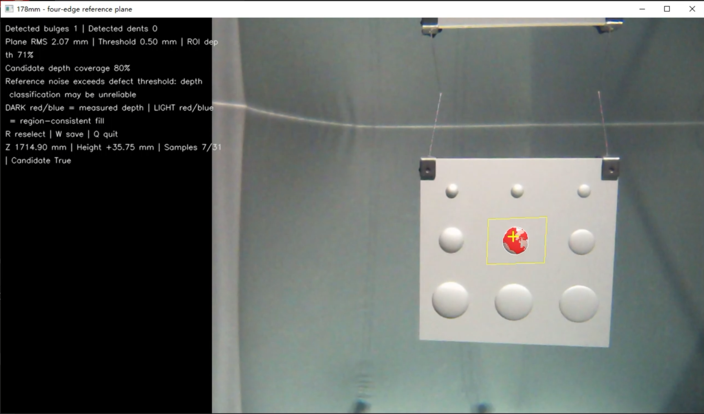

# 水下双目表面缺陷测量工具箱

简体中文 · [English](README_EN.md)

用一台左右拼接输出的双目相机，测量水下构件表面局部凸起的高度和凹陷的深度。在校正后的左图中点选四个角，框住缺陷及周围的平整表面。程序利用双目视差恢复深度，拟合局部参考面，并用毫米显示缺陷相对该面的形变量。典型试件包括带台阶的金属板和 CNC 加工的圆形凸起、凹陷。

[](演示视频.mp4)

[查看测量演示视频](演示视频.mp4)

## 快速体验

**Windows 演示。** 完整解压 Windows 发行包，保留 `_internal` 文件夹与 `stereo_review.exe` 的相对位置，双击 EXE。点击首页图片即可播放演示视频，无需连接相机。实时测量可按下文从源码启动。

**从源码运行。** 在 Windows 上安装带 Tkinter 的 Python 3.9 或 3.12，进入项目根目录后执行：

```powershell
python -m venv .venv
.\.venv\Scripts\python.exe -m pip install numpy opencv-python scipy
.\.venv\Scripts\python.exe stereo_review.py
```

如需快速检查数值读取，可以运行内置合成样例。下面的命令查询一个凹陷点，预期有符号高度为 `-3.00 mm`。

```powershell
.\.venv\Scripts\python.exe stereo_review.py --demo --point 146 241
```

## 实时测量

1. **导入标定。** 在主界面点击「导入双目相机标定数据」，选择与当前相机和水下成像条件对应的 `.mat` 文件。导入成功后，「实时相机测量」按钮启用。
2. **连接相机。** 相机应通过同一视频流输出同步的左右画面。例如，两幅 1280 × 720 图像拼成 2560 × 720（32:9），两幅 640 × 480 图像拼成 1280 × 480（8:3）。软件检查实际画幅及其与标定尺寸的匹配情况。
3. **选区测量。** 点击「实时相机测量」，在左目窗口依次点选四个角。让四角落在缺陷周围完好的平整表面，采集时保持相机和试件静止。程序累计多帧有效深度后拟合参考面，并叠加缺陷区域。
4. **读数与保存。** 点击缺陷查看相机深度和相对高度。按 `W` 保存本次测量，按 `R` 重选区域，按 `Q` 或 `Esc` 退出测量窗口。

## 读懂测量结果

| 图上标记 | 含义 |
| --- | --- |
| 红色 / 蓝色 | 默认视图下，红色表示凸起，蓝色表示凹陷。 |
| 深色 / 浅色 | 深色缺陷像素有实测深度，浅色表示根据同一区域推测的范围。缺测点不作为零高度参与读数。 |
| 相机深度 Z | 测点沿校正相机光轴的深度，单位为 mm。 |
| 有符号高度 | 同一像素处的参考面深度减去测点深度。正值表示向相机凸起，负值表示凹陷。 |

在首页点击「打开测量记录」，选择同时含有 `measurement.npz` 和 `summary.json` 的结果目录，即可重新查点。「导出当前记录 CSV」按缺陷区域导出类别、有效深度覆盖率、有符号高度中位数等数据。首页的「导出历史试验 CSV」单独提供已有水池试验的汇总数据。

## 标定文件

数值型 MAT 可包含 `K1`、`D1`、`K2`、`D2`、`R`、`T` 和 `imageSize`。矩阵采用 OpenCV 约定，`imageSize` 按单目图像的 **[高, 宽]** 排列。`worldUnits` 指定平移向量的单位，缺少时，界面会询问。

对于 MATLAB 原生 `stereoParameters` 对象，可使用 MATLAB 和 Computer Vision Toolbox 转为数值 MAT。将项目根目录加入 MATLAB 路径，在含有标定对象 `stereoParams` 的工作区运行：

```matlab
export_stereo_mat(stereoParams, 'stereo_numeric.mat')
```

随后在主界面选择生成的文件。使用弱纹理、反光或倾斜试件时，请结合有效深度覆盖率及参考面拟合残差解释测量结果。
