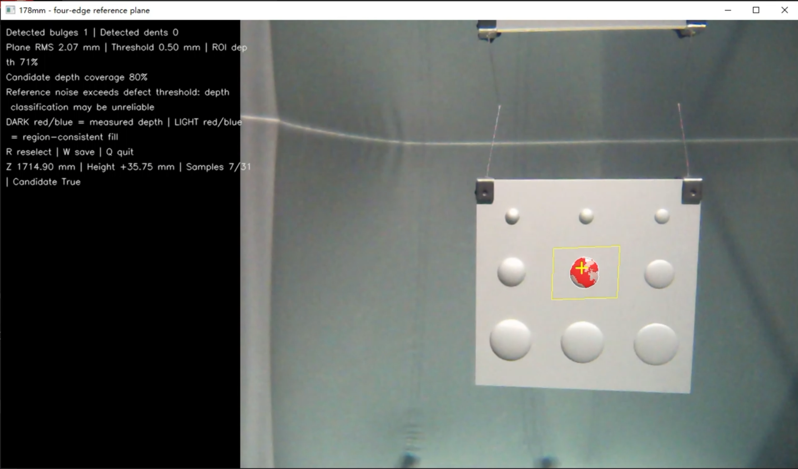

# Underwater Stereo Defect Measurement

[简体中文](README.md) · English

Measure the height of a protrusion or the depth of a dent on a submerged surface using a side-by-side stereo camera. Select four corners in the rectified left image to enclose the defect and the surrounding flat surface. The application reconstructs depth from stereo disparity, fits a local reference plane, and reports signed displacement in millimeters. Example specimens include stepped metal plates and CNC-machined circular protrusions and dents.

[](演示视频.mp4)

[Watch the measurement demo](演示视频.mp4)

## Quick start

**Windows demo.** Extract the entire Windows distribution and keep the `_internal` directory alongside `stereo_review.exe`. Launch the executable and click the image on the home screen to play the video. The demo works without a camera. For live measurements, use the source instructions below.

**Run from source.** On Windows, install Python 3.9 or 3.12 with Tkinter. From the project root, run:

```powershell
python -m venv .venv
.\.venv\Scripts\python.exe -m pip install numpy opencv-python scipy
.\.venv\Scripts\python.exe stereo_review.py
```

To check point readout without hardware, query a dent in the built-in synthetic example. The expected signed height at this point is `-3.00 mm`.

```powershell
.\.venv\Scripts\python.exe stereo_review.py --demo --point 146 241
```

## Take a live measurement

1. **Import calibration.** Select **导入双目相机标定数据** (Import stereo calibration) and choose a `.mat` file for your camera and underwater imaging setup. A successful import enables the live measurement button.
2. **Connect the camera.** The camera must deliver synchronized left and right images in one side-by-side stream. For example, two 1280 × 720 views produce a 2560 × 720 frame (32:9), and two 640 × 480 views produce a 1280 × 480 frame (8:3). The application checks the captured frame dimensions against the calibration.
3. **Select the region.** Click **实时相机测量** (Live measurement). In the left-camera window, click four corners on the intact, flat surface surrounding the defect. Keep the camera and specimen still during capture. The application combines valid depth observations across frames, fits a reference plane, and overlays the detected regions.
4. **Inspect and save.** Click a defect to read its camera depth and relative height. Press `W` to save, `R` to select a new region, or `Q` or `Esc` to close the measurement window.

## Interpret the result

| Display | Meaning |
| --- | --- |
| Red / blue | In the default view, red marks a protrusion and blue marks a dent. |
| Dark / light shading | Dark defect pixels have measured depth. Light shading marks the inferred extent of the same region. Missing depth is excluded from point readouts. |
| Camera depth Z | Depth along the rectified camera's optical axis, in mm. |
| Signed height | Reference-plane depth minus measured depth at the same pixel. Positive values indicate protrusions toward the camera. Negative values indicate dents. |

Select **打开测量记录** (Open measurement record) and choose a result directory containing both `measurement.npz` and `summary.json` to inspect saved points. **导出当前记录 CSV** (Export current record) exports one row per region, with its classification, valid depth coverage, and median signed height. The home screen offers a separate CSV of historical pool experiment results.

## Calibration files

A numeric MAT file can contain `K1`, `D1`, `K2`, `D2`, `R`, `T`, and `imageSize`. Matrices use OpenCV conventions. Set `imageSize` to **[height, width] for one camera**. Use `worldUnits` to specify the translation unit. If it is missing, the application prompts for it.

To convert a native MATLAB `stereoParameters` object, use MATLAB with Computer Vision Toolbox. Add the project root to the MATLAB path and run this command in the workspace containing your calibration object, `stereoParams`:

```matlab
export_stereo_mat(stereoParams, 'stereo_numeric.mat')
```

Import the resulting file in the application. For low-texture, reflective, or tilted specimens, use depth coverage and the reference-plane fit residual to judge the measurement.
